# Loocap 架构评审 — 2026-10-29

> 执行者:Tab · 基线 commit `2264770` · 事实源 = 代码(`AudioRecordApp/` 19.9k 行、`AudioRecordKit/Sources` 8.6k 行、Kit 单测 1.1k 行)
> 配套图:[`技术架构图.html`](./技术架构图.html)(浏览器打开,含总分层图 + 五条链路 + 磁盘资产 + 边界对比)
> 状态:**评审结论,未改动任何代码**。整改项需按 Loop 协议建单、带验收标准、老板签字后再开工。

---

## 一、一句话结论

**分层意图是对的,边界执行失守。** 「SDK + App」的两层结构、录制器策略模式、编辑命令栈、波形 LOD 分块都是成熟设计;
但 SDK 只存在于目录里——构建时被平铺成同一个 module,App 绕过公开 API 直接吃 Kit 内部类,
导致 SDK 无法独立交付、编辑与保存逻辑堆进了控制器、加密与转写的安全口径不一致。
功能迭代期可以带着跑,**一旦要「对外交付 SDK」或「编辑长录音(会议)」,这三处会同时成为阻塞点**。

主观评分(0–10,仅供排序,不是 KPI):

| 维度 | 分 | 一句话 |
|---|---|---|
| 分层意图 | 8 | Kit 不依赖 App;录制 / 编辑 / 转写 / 导出职责切得开 |
| 边界执行 | 4 | 平铺编译 + 直连 internal,编译器不守边界 |
| SDK 可交付度 | 4 | 公开 API 只覆盖 mic / 混音,缺 App 真实用到的能力;Kit 混入 AppKit |
| 编辑器扩展性 | 5 | 命令栈好,但整文件 PCM 驻留 + 破坏性回写限制了长音频与非破坏性编辑 |
| 可测试性 | 4 | 最该单测的 DSP / 加密 / 录制器零覆盖 |
| 可维护性(体量) | 5 | 4 个文件占 App 26%;死代码未清 |

---

## 二、当前架构(文字版,配图见 HTML)

```
L5 表现层     Views/ · Views/Editor/                 AppKit 视图(窗口骨架 / 录制区 / 编辑区)
L4 控制层     MainViewController(1561) · AudioRecorderController(574) · EditorViewController(1548) · AppDelegate
L3 应用服务   Editor/(Session·History·Commands·波形引擎) · Services/(Export·Transcription·LiveCoordinator)
──── 本应在此处有 SDK 编译边界(现状:被平铺,见 A1)────
L2 SDK 公开面 API/(AudioRecordAPI·MediaStream·Types) · CAPI/(AudioRecord_* 29 个导出) · Transcription 协议与模型
L1 SDK 内部   Recorders · ProcessTap 子系统 · 麦克风(AUHAL) · AppleSpeechEngine · 加密/存储 · 基础设施
L0 系统       CoreAudio · AudioToolbox · AVFoundation · Speech(26+) · CryptoKit · ffmpeg(子进程) · 沙盒/TCC
```



```mermaid
flowchart TB
  subgraph APP[AudioRecordApp]
    V[Views / Views/Editor] --> C[MainVC · AudioRecorderController · EditorVC]
    C --> E[Editor 域: Session · History · Commands · 波形引擎]
    C --> S[Services: Export · Transcription · LiveCoordinator]
  end
  subgraph KIT[AudioRecordKit]
    API[API / CAPI / Transcription 协议]
    REC[Recorders: Mic · Mixed · ProcessTap]
    TAP[ProcessTap: Enumerator · Tap · Aggregate · IOProc]
    SEC[Vault: AudioFileEncryptor · SecureDelete · FileManagerUtils]
    ASR[AppleSpeechEngine]
    API --> REC --> TAP
  end
  C -. 直连 internal .-> REC
  C -. 直连 internal .-> SEC
  S -. 硬编码 .-> ASR
  TAP --> CA[(CoreAudio)]
  ASR --> SP[(Speech 26+)]
  S --> FF[(ffmpeg 子进程)]
```

### 五条链路速览

| 链路 | 路径 | 关键约束 |
|---|---|---|
| 录制 | Sidebar/ControlPanel → MainVC → AudioRecorderController → Recorder → Enumerator→Tap→Aggregate→IOProc → 临时 M4A | 全局 Tap 依附输出设备时钟,系统静音要 `SilentOutputKeepAlive`(FIX-004);麦克风注入走环形缓冲在 IO 回调混入(FIX-007) |
| 保存 | `onRecordingComplete` → 0 秒/静音拦截 → 构造元数据 → AES-256-GCM → `.arlock` → 覆写删除临时 M4A | 失败保留 M4A 兜底;**整段在 MainViewController 内** |
| 编辑 | SessionManager(LRU 3/450MB) → 解密临时 m4a → 整文件读入 PCM → EditHistory(20 步) → `finalizeEdit` 重编码重加密 | 波形显示走 TileProvider(LOD + 双层缓存),与 PCM 解耦 |
| 转写 | 实时:`onAudioBuffer`→Coordinator→LiveSession;文件:解密→`AppleSpeechEngine`→sidecar JSON | FIX-012:`.arlock` 落点登记与 finish 完成双向握手后才落盘 |
| 导出 | 导出卡片 → 解密临时 m4a → 直拷 / AVAudioFile / ffmpeg → `SecureDelete` | mp3/flac/ogg 依赖内置 ffmpeg 子进程(沙盒 temporary-exception) |

---

## 三、做得对的地方(保持)

1. **依赖单向**:Kit 不 import App、自带 `L10n.swift`,没有反向耦合。
2. **录制器策略 + 模板基类**:`AudioRecorderProtocol` / `BaseAudioRecorder` + Mic / Mixed / ProcessTap 三实现,新增来源成本低。
3. **ProcessTap 子系统拆件合理**:Enumerator / Tap / Aggregate / Callback / File 各司其职,CoreAudio 的复杂度被隔离在 Kit 里。
4. **状态通道结构化(REL-002)**:`onStateChange(RecordingState)` 取代文案 `contains` 判断,C API 数值契约(0–3)稳定。
5. **编辑命令栈**:`EditCommand` 协议 + `EditHistory`,每个操作自带 undo 数据,新增编辑能力是加一个类。
6. **波形引擎**:LOD 分块 + `NSCache` + 磁盘缓存 + 视口优先级 + 请求代际取消 + 算法版本号失效——显示层与 PCM 解耦,是正确且难得的设计。
7. **`.arlock` 容器自描述**:magic / version / flags / key_id / 独立 nonce,格式可演进。
8. **转写双握手(FIX-012)**:根治「管线先读、finish 后写」的落盘竞态。
9. **可观测性**:`UXEventLog` + os_log 双通道 + E2E lite,问题能用证据闭环。

---

## 四、问题清单

### A1 · P0 · SDK 边界名存实亡

**事实**
- `build-app.sh`:`SDK_SOURCES` 与 `APP_SOURCES` 拼进同一条 `swiftc`;`project.yml` 的 App target `sources` 也同时包含 `AudioRecordKit/Sources`。`TranscriptionService.swift:3` 的注释直接写着「勿 import AudioRecordKit」。
- App 大量使用 Kit **internal** 类:`PermissionManager`、`MixedAudioRecorder`、`CoreAudioProcessTapRecorder`、`MicrophoneRecorder`、`FileManagerUtils`、`AudioFileEncryptor`、`SecureDelete`、`AudioProcessEnumerator`、`Logger`……(这些在 Kit 里都不是 `public`,能编过只因为同 module)。
- 公开入口 `AudioRecordAPI` 在 `AudioRecordApp/` 内**引用数为 0**,且只支持 `microphone` / `systemMixdown`,缺少 App 真实在用的:指定进程、多源并行、多进程独立录制、录音中麦克风混入(`setMicMixEnabled`)、`onAudioBuffer`。
- `AudioRecordAPI` 标 `@available(macOS 14.4)`,而 `Package.swift` / `project.yml` 部署目标是 13.0。

**后果**
- SDK 没有真实消费者,C API / Swift API 只被单测触达,**它们是否真的可用没人在日常使用中验证**。
- 想把 SDK 交给别的 App 用,需要先重做公开面;现在 `public` 的边界和产品能力脱节。
- 任何 Kit 内部改动对 App 都是源码级破坏,没有 ABI/API 缓冲。

**建议**:见第五节 R3。目标是 App 只依赖 public API,迫使 API 补齐真实能力。

### A2 · P0 · MainViewController 上帝类

**事实**:1561 行,MARK 段 25+,承担:录制生命周期、**加密落盘管线(L445–590)**、显示名生成、计时、列表播放(解密→临时→AVAudioPlayer→清理)、模式管理、权限、文件列表(.arlock 元数据)、进程刷新与退出监控、防休眠、磁盘空间监控、崩溃恢复(临时文件扫描)、编辑器进出与委托。

**后果**
- 保存管线(最重要的数据落盘路径)无法脱离 UI 单测;改播放可能影响落盘。
- 与 `MainWindowViewDelegate` 绑定,逻辑与视图耦合。
- 新同学/新会话读懂成本高,Loop 中 UI 单(如 UI-026)改动容易误伤。

**建议**:抽 `RecordingFinalizer`(拦截 + 元数据 + 加密 + 安全删除,纯逻辑、可单测)、`PlaybackController`、`RecordingHealthMonitor`(磁盘/休眠/进程退出/崩溃恢复),MainVC 只剩编排。

### A3 · P1 · 编辑器内存模型与数据模型分裂

**事实**
- `EditorSession.loadAudio`:`AVAudioFile.read(into:)` 把**整文件**解码为 Float32 PCM 常驻内存。
- 估算:48kHz 立体声 Float32 = 384 KB/s,**1 小时 ≈ 1.38 GB**;`EditorSessionManager` 总上限 450MB(≈ 19.5 分钟立体声)。会议录音很容易超过。
- 保存路径 `finalizeEdit`:缓冲 → AAC **重编码** → 重加密,每次保存都有一代有损累积。
- 编辑有两套模型:`EditCommand` 在**单个 PCM buffer** 上做破坏性变换;`AudioClip` / `EditorAudioTrack`(含 sourceStart/timelineStart/fade/mute/solo 等字段)只被 `Views/Editor/*` 与 `EditorViewController` 使用,并不是命令栈操作的数据。`SplitAudioClipCommand` 放在 `Views/` 下也是这个分裂的痕迹。

**后果**:长音频内存压力 / 被 LRU 淘汰后体验抖动;无法做真正的非破坏性剪辑(剪映式「分割、移动、多段」);多轨/多片段的 UI 已有,但数据层撑不住。

**建议**:短期 —— 对超长文件做明确降级(超阈值提示 / 只读波形 + 分段加载);中期 —— 以 `AudioClip` 列表(EDL)为唯一编辑模型,渲染/导出时按 EDL 合成,PCM 按需分段读取;保存改为「原音频 + EDL」或仅在导出时落音频。

### A4 · P1 · 加密口径不一致,解密中转四处重复

**事实**
- 音频是 AES-256-GCM 的 `.arlock`,但转写文稿 `<uuid>.atranscript.json` 是**明文 pretty JSON**,紧挨着放(`TranscriptionService.save`)。转写内容 ≈ 音频语义,泄露面等价。
- 「解密 → 临时明文 m4a → 用完删」在**播放 / 编辑 / 导出 / 转写**四处各自实现;清理方式不一:导出用 `SecureDelete`,转写用 `FileManager.removeItem`。
- 主密钥硬编码 + 设备指纹派生——代码注释已把它定位为「版权保护层,非 DRM」,**这是已声明的取舍,不算缺陷**,但对外文案不得宣称「军工级」。

**建议**:抽一个作用域 API `Vault.withPlainFile(url) { tempURL in … }`,统一创建 / 权限 0600 / `SecureDelete` / 异常路径清理;转写文稿并入 `.arlock` 元数据块或同样加密成 sidecar。

### A5 · P1 · SDK 混入 UI 依赖

**事实**:Kit 内 7 个文件 `import AppKit/Cocoa`(`Types`、`Logger`、`FileManagerUtils`、`PermissionManager`、`AudioProcessEnumerator`、`AudioRecordSDK_C`、`LoocapTheme`)。`LoocapTheme.swift`(78 行)只被自身引用,疑似死代码,且与 App 的 `IndustrialDesignTokens`(483 行)形成两套设计 token。

**后果**:SDK 不能无头(CLI / 后台服务)使用;C API 的使用者被迫链接 AppKit。

**建议**:逐个核对 AppKit 使用点(多半是 `NSWorkspace` / `NSRunningApplication`),要么下沉为协议注入,要么换 Foundation 等价物;删除 `LoocapTheme`。

### A6 · P1 · 转写引擎抽象未落地

**事实**:`TranscriptionEngine` 协议设计为「Apple 默认 + Whisper 高精(S4)」,但 `TranscriptionService.transcribeRecording` 里直接 `AppleSpeechEngine()` 并包 `#available(macOS 26.0)`,无注入点;`WhisperCppEngine` 不存在。App 部署目标 13.0,**13–25 的用户完全没有转写**,且 App 内**没有调用** `AppleSpeechEngine.isSupported()`(grep 0 命中),无能力探测驱动的 UI 降级。

**建议**:`TranscriptionService` 接收 `engineProvider`;启动时用 `AppleSpeechEngine.isSupported()` 做能力探测并驱动 UI;S4 立项时再接 Whisper。

### A7 · P1 · 测试金字塔倒挂

**事实**:Kit 单测(92 例,10-29 合并态回归全绿)集中在 模型 / 格式 / 文件名 / 权限 / 日志 / 电平映射;**没有任何测试引用** `AudioFileEncryptor`、`ArlockMetadata`、`TrimCommand` / `FadeCommand` / `NormalizeCommand` / `SilenceTrimCommand` / `EditHistory`、任何 Recorder。而这些恰恰是「纯函数 + 数据丢失风险最高」的部分,也最容易单测(buffer in → buffer out;加密 → 解密 round-trip)。当前对它们的保护只有 E2E / lite 通道。

**建议**:优先补两组:① 加密 round-trip + 篡改检测 + 版本/魔数错误;② 每个 EditCommand 的 execute→undo 恒等与边界(0 长度、选区越界、单声道/立体声)。

### A8 · P2 · 死代码与重复实现

| 项 | 证据 |
|---|---|
| `ScreenCaptureAudioRecorder` | 19 行空桩,注释「TODO: 清理 pbxproj 中的引用」 |
| `ProcessTapManager` vs `SwiftProcessTapManager` | 同职责双实现(C API / Swift API),引用分别在 3 / 2 个文件 |
| `TracksView`(538 行) | `MainWindowView` 里 `tracksView.isHidden = true // 旧 TracksView 始终隐藏` |
| `RecordingTracksView`(4 行)、`MultiProcessLevelView`(8 行) | 空壳 |
| `ControlPanelView.swift.bak` | 备份文件进了源码目录 |
| 两套 design token | `IndustrialDesignTokens`(App) + `LoocapTheme`(Kit) |
| 两套编辑工具栏 | `EditorToolbar`(Views/Editor)与 `EditToolbarView`(Views),职责边界不清 |
| 命令类放 `Views/` | `SplitAudioClipCommand`、`DeleteSelectionCommand` |
| 业务逻辑在 View | `TranscriptPanelView.markdown(for:)` 做导出文本格式化,EditorVC 直接调用 |
| `AudioSource`(Views) vs `AudioSourceType`(Controllers) | 同一概念两个类型 |
| 根目录杂物 | `build.trash-*`(两个)、`ffmpeg-8.1.2 (1).7z`(17MB)、`.DS_Store` |
| 过期文档 | `ARCHITECTURE_DIAGRAM.txt` / `AUDIO_EDITOR_CODE_MAP.md` / `QUICK_REFERENCE.md` 停在 5 月(V2 之前) |

### A9 · P2 · 构建入口四套

`build-app.sh`(swiftc 平铺,实际主线)、`project.yml` → xcodeproj(XCUITest 用)、`AudioRecordKit/Package.swift`(仅跑 Kit 单测)、`AudioRecordApp/build.sh`(旧)。平铺编译与独立模块编译的可见性/符号语义不同,LOOP-02 的 `String.localized` 分层断裂就是这类问题;A1 修复后可收敛为 SwiftPM + xcodebuild 一套。

### A10 · P2 · 并发与状态

- 回调靠闭包 + `DispatchQueue` + `NSLock`;全工程 15 处 `static let shared` 单例。
- Kit 内 12 处 `static var`(`CallCounter` / `FirstShot` 调试打点),部分位于 **IO 回调热路径**,非线程安全(仅调试用途,但存在数据竞争)——建议 `#if DEBUG` 包裹或改原子/`os_signpost`。
- 录制状态分布在 `RecordingState` 枚举、`onStatus` 文案、`AudioRecorderController` 聚合回调、`MainWindowView.ViewMode` 三态,缺单一状态源(REL-002 已解决一半)。

---

## 五、整改路线(建议,未建单)

| 阶段 | 内容 | 成本 | 风险 | 验收要点 |
|---|---|---|---|---|
| **R1 清理** | 删 A8 死代码/杂物/`.bak`;过期文档归档;删 `LoocapTheme`;把 2 个命令类移到 `Editor/` | 0.5–1 天 | 低 | `build-app.sh` exit 0;SDK 单测基线不回退;lite 6/6 |
| **R2 收口** | 抽 `RecordingFinalizer` + `Vault.withPlainFile`;转写 sidecar 加密;补 A7 两组单测 | 2–3 天 | 中(动落盘路径) | 加密 round-trip 单测;录制→落盘→转写→导出 E2E 全绿;临时文件零残留(`ls $TMPDIR`) |
| **R3 立边界** | Kit 去 AppKit;SwiftPM 拆 target(Capture / Vault / Transcribe / EditorCore);App 仅依赖 public API;补齐 `AudioRecordAPI` 能力;构建收敛 | 5–8 天 | 高(全工程编译面变化) | App 内 `AudioRecordAPI`/公开 API 引用 > 0;Kit 内无 AppKit import;单一构建入口 |
| **R4 编辑器重构** | EDL 作为唯一模型;PCM 分段读取;导出时合成 | 8–15 天 | 高 | 2 小时录音可打开/剪辑,峰值内存 < 500MB;保存无二次有损 |
| **R5 引擎可插拔** | `engineProvider` 注入 + 能力探测 UI;S4 Whisper | 视 S4 | 中 | macOS 13–25 UI 正确降级 |

建议顺序:**R1 → R2 → (按业务优先级决定 R3 / R4)**。若近期不对外交付 SDK,R3 可后置,但 A5(去 AppKit)与 A1 的「补公开 API」值得提前做,代价小、能阻止边界继续腐蚀。

> 以上整改项均未写入 `TODOS.md`(避免与进行中的 Loop 单冲突),待老板确认优先级后按 FEAT/INFRA-NNN 起草并带验收标准。

---

## 六、本次评审未核实 / 局限

- 未实测运行与性能数据;内存数字为按采样参数的**理论估算**。
- 未核实:编辑后转写时间戳是否随裁剪重映射;macOS 13–25 上转写入口的实际表现(只确认了 App 不调用 `isSupported()`,未实机验证)。
- 引用计数基于 `grep` 字符串匹配,未做符号级静态分析;个别「疑似死代码」需编译删除验证。
- 评分为主观判断,仅用于整改排序。
